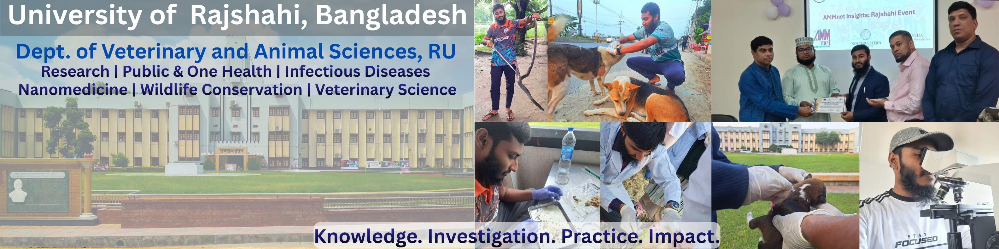

<!-- ============================================================
     ✦ MD. NAFIZUR RAHMAN — GitHub Profile ✦
     Glassmorphism · Navy #0F4C81 · Royal #1B4D8C · Sky #5AA9E6
     ============================================================ -->

<!-- ─────────────  BANNER  ───────────── -->

<!-- ─────────────  ANIMATED HEADER  ───────────── -->

<!-- Glassy gradient divider -->

 

<!-- Profile views (kept functional) -->

  

<!-- ─────────────  BUILDING IN PUBLIC  ───────────── -->

### 🧑‍💻 The Technical Side — Building by _Vibe Coding_

<table align="center">
<tr>
<td width="100%" style="border-radius:16px; border:1px solid #36BCF755; background: linear-gradient(135deg, #0F4C8110, #1B4D8C10, #5AA9E610); padding: 20px;">

Beyond the lab coat, I'm a **self-driven developer** who ships real products
through **"Vibe Coding"** — an AI-assisted, rapid-prototyping workflow where a
clear idea turns into a working app in days, not months. I work primarily with
**Python, SQL, and the web stack (HTML · CSS · JavaScript)**, pairing clean
backend logic with modern, responsive interfaces.

**🚀 Active Repositories**

| Project                                                                                                               | What it is                                                                                                  |
| :-------------------------------------------------------------------------------------------------------------------- | :---------------------------------------------------------------------------------------------------------- |
| [**Professors-Vet-And-Pet-Care-Website**](https://github.com/mdnafizurrahman8024/Professors-Vet-And-Pet-Care-Website) | Django clinic-management + pet e-commerce platform — bookings, surgery gallery, POS inventory & admin panel |
| [**Zun-Synthesis-Academy-Website**](https://github.com/mdnafizurrahman8024/Zun-Synthesis-Academy-Website)             | Premium ed-tech platform bridging biology and technology — Python backend, Tailwind CSS frontend            |
| [**PoultryMedix-Project-Overview**](https://github.com/mdnafizurrahman8024/PoultryMedix-Project-Overview)             | 🩺 PoultryMedix — veterinary decision-support app for poultry health (in development)                       |
| [**Python-Foundation-21-Days**](https://github.com/mdnafizurrahman8024/Python-Foundation-21-Days)                     | A 21-day Python challenge — daily practice building consistency and practical skill                         |
| [**project-bank-management-system**](https://github.com/mdnafizurrahman8024/project-bank-management-system)           | A banking management system built as a hands-on software-engineering exercise                               |

**⚡ ZunSync-Software** is currently in active private development and will be
published here soon.

I'm **continuously learning** — every repository is a step further into
bioinformatics pipelines, data dashboards, and AI-driven tools. **More exciting
projects and features are on the way.** 🌱

</td>
</tr>
</table>

 

<!-- ─────────────  ABOUT ME  ───────────── -->
<h2 align="center">
  
</h2>

<table align="center">
<tr>
<td width="100%" style="border-radius:16px; border:1px solid #5AA9E655; background: linear-gradient(135deg, #0F4C8112, #1B4D8C12, #5AA9E612); padding: 22px;">

I'm a **Doctor of Veterinary Medicine (DVM)** student at the **University of
Rajshahi, Bangladesh**, with an academic foundation spanning **Anatomy,
Histology, Physiology, Pathology, Parasitology, Microbiology, Medicine, Surgery,
Epidemiology, and Public Health**.

My core passion lies in **bridging traditional veterinary science with advanced
computational science** — Bioinformatics, Artificial Intelligence, and Data
Analytics — to improve **animal welfare, public health, and disease
prevention**. 🐾⚕️🧬

I'm a strong advocate for the **Ethical Use of AI** in research and healthcare,
and I actively use **"Vibe Coding"** for rapid prototyping — with hands-on
experience building **web apps, mobile apps, websites, and software**. I'm
currently developing the **🩺 PoultryMedix** mobile app and the **⚡ ZunSync**
software.

> 💡 _"The future of veterinary medicine won't be written at the microscope
> alone — it will be compiled at the intersection of biology and code."_

</td>
</tr>
</table>

 

<!-- ─────────────  TECH STACK  ───────────── -->
<h2 align="center">
  
</h2>

<table>
<tr>
<td align="center" width="50%" valign="top">

**🐍 Programming & Analytics**

 

  

**📊 Data Visualization & Statistics**

</td>
<td align="center" width="50%" valign="top">

**🧬 Bioinformatics & Computational Biology**

  

**💡 Concepts & Expertise**

  

**🤝 Soft Skills**

</td>
</tr>
</table>

 

<!-- ─────────────  RESEARCH  ───────────── -->
<h2 align="center">
  
</h2>

<table align="center">
<tr>
<td width="100%" style="border-radius:16px; border:1px solid #36BCF755; background: linear-gradient(135deg, #0F4C810E, #5AA9E60E); padding: 20px;">

- **🛡️ Clinical Surveillance & Antimicrobial Stewardship** — _One Health_
  project on veterinary prescribing patterns, owner KAP (Knowledge, Attitudes &
  Practices), and self-medication in companion animals.
- **💠 Nanomedicine & Computational Biology** — Meta-analysis on
  **nanoparticle-based Rabies vaccines** (immunogenicity, efficacy, safety) and
  nanoparticle **remediation of heavy-metal bioaccumulation** in livestock.
- **🦠 Epidemiology & Parasitology** — Ectoparasites in free-roaming dogs
  (_Barind Tract_), molecular detection of _Capillaria_ spp. in native poultry,
  and bedbug (_Cimex_ spp.) risk factors in student residences.
- **💧 Water Quality & Livestock Health** — Interdisciplinary assessments of
  livestock drinking water, bacterial biofilms, and pathological impacts of
  heavy metals.
- **🐕‍🦺 Socio-Veterinary Studies** — Socio-veterinary determinants of pet
  healthcare and ownership patterns in Bangladesh.

</td>
</tr>
</table>

 

<!-- ─────────────  EXTRACURRICULAR  ───────────── -->
<h2 align="center">
  
</h2>

| 🐍 Wildlife Rescue                                                                                                          | 🏥 Clinical Outreach                                                                        |
| :-------------------------------------------------------------------------------------------------------------------------- | :------------------------------------------------------------------------------------------ |
| Active wildlife rescue advocate — hands-on **snake rescue operations** with **SWAN (Save Wildlife and Nature) Bangladesh**. | Providing **free clinical services** and **event management** for stray and campus animals. |

 

<!-- ─────────────  GITHUB STATS  ───────────── -->
<h2 align="center">
  
</h2>

 

 

 

 

<!-- ─────────────  CONNECT  ───────────── -->
<h2 align="center">
  
</h2>

  
  

  
  
  

  
  
  
  
  

 

<!-- ─────────────  RESUME & PORTFOLIO BUTTONS  ───────────── -->

  
  &nbsp;&nbsp;
  

 

<!-- ─────────────  FOOTER  ───────────── -->

⭐ <i>From molecules to models — coding for animal health, one commit at a
time.</i>

